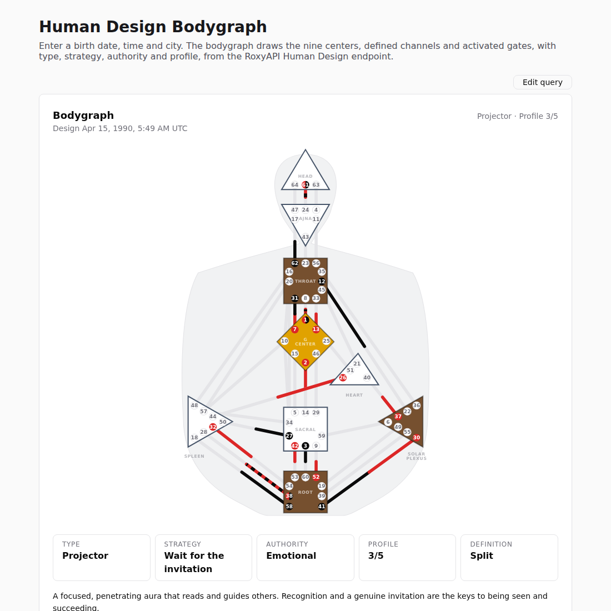

# Human Design Bodygraph Component

A Human Design bodygraph web component that draws the nine centers, defined channels and activated gates from a birth date, time and city, built by RoxyAPI. It is part of [`@roxyapi/ui`](https://roxyapi.com/ui), the UI components for RoxyAPI: one API key across 18+ insight domains, from Western and Vedic astrology to Human Design, tarot and numerology.

[](https://roxyapi.com/ui)

## Copy and paste

```html
<script src="https://cdn.jsdelivr.net/npm/@roxyapi/ui@latest/dist/cdn/roxy-ui.js" defer></script>
<roxy-bodygraph data-endpoint="human-design/bodygraph" publishable-key="pk_live_YOUR_KEY" hide-sections="hint"></roxy-bodygraph>
```

Two lines, any page, no build step. The element renders a birth data form with a city search, calls the RoxyAPI Human Design bodygraph endpoint on submit and draws the chart. Replace `pk_live_YOUR_KEY` with a publishable key from your [RoxyAPI account](https://roxyapi.com/pricing) and add each site you embed on to the allowed origins of that key.

## Run the demo

```bash
git clone https://github.com/RoxyAPI/human-design-bodygraph.git
cd human-design-bodygraph
npx serve .
```

Put your publishable key in `index.html`, add your local address to its allowed origins, and open the page. Enter a date, a time and a birth city and the bodygraph renders as in the screenshot above.

## React and Next.js

Install one package, `@roxyapi/ui-react`. It carries the response types, so nothing else is needed to render.

```tsx
'use client';
import { RoxyBodygraph } from '@roxyapi/ui-react';

export function Bodygraph() {
	return <RoxyBodygraph endpoint="human-design/bodygraph" publishableKey={process.env.NEXT_PUBLIC_ROXY_PK} hideSections="hint" />;
}
```

To keep every key on your server, fetch with the TypeScript SDK and pass the response as `data`. Geocode the birth city first so the birth time is read in the right timezone.

```tsx
// app/page.tsx (Server Component)
import { createRoxy } from '@roxyapi/sdk';
import { BodygraphView } from './bodygraph-view';

const roxy = createRoxy(process.env.ROXY_API_KEY!);

export default async function Page() {
	const { data: places } = await roxy.location.searchCities({ query: { q: 'New York' } });
	const { latitude, longitude, timezone } = places.cities[0];
	const { data } = await roxy.humanDesign.generateBodygraph({
		body: { date: '1990-07-15', time: '14:30:00', latitude, longitude, timezone },
	});
	return <BodygraphView data={data} />;
}
```

```tsx
// app/bodygraph-view.tsx (Client Component)
'use client';
import { RoxyBodygraph, type RoxyBodygraphProps } from '@roxyapi/ui-react';

export function BodygraphView({ data }: { data: RoxyBodygraphProps['data'] }) {
	return <RoxyBodygraph data={data} />;
}
```

Vue and Nuxt use `@roxyapi/ui-vue` with the same component and prop names. Svelte, Angular, Astro and plain HTML use the `<roxy-bodygraph>` tag directly.

## What does the bodygraph show?

The nine centers in their traditional shapes and colours, filled when defined and outlined when open, all 36 channels and 64 gates over a body silhouette, and every activated gate marked by source: Personality in the text colour, black on a light page, and Design in red. The header carries the type, the profile and the Design date. Below the chart sit tiles for type, strategy, authority, profile and definition.

## What readings come with the chart?

A written reading for the type, strategy, authority, profile and definition, the aura, the incarnation cross, the defined channels grouped by circuit, every center with its not-self question, and each Personality and Design activation with its gate and line meaning. Add `hide-readings` to keep the chart and drop the prose.

## How is the Design moment calculated?

The Design side is the instant the Sun stood 88 degrees of arc before its birth position, about three months before birth, and the chart prints that date. Every planet position comes from Roxy Ephemeris, which reads the NASA JPL DE440 ephemeris directly and is verified against NASA JPL Horizons; see the [methodology page](https://roxyapi.com/methodology).

## Can the readings be translated?

Yes. Set `lang` on the element or the page (`de`, `es`, `fr`, `hi`, `pt`, `ru`, `tr` and more) and the type, strategy, authority, profile, channel, center, gate and line readings come back in that language.

## How do I theme it or switch to dark mode?

Set one token and every chart on the page follows: `:root { --roxy-accent: #8b5cf6; }`. Dark mode works with no wiring, through the visitor system setting, a `.dark` class or `data-theme="dark"` on any ancestor. Every token is listed in the [theming guide](https://github.com/RoxyAPI/ui#theming).

## Resources

- Every component, live: [roxyapi.com/ui](https://roxyapi.com/ui)
- Source and full docs: [github.com/RoxyAPI/ui](https://github.com/RoxyAPI/ui)
- Bodygraph endpoint: [roxyapi.com/products/human-design-api](https://roxyapi.com/products/human-design-api)
- Plans and keys: [roxyapi.com/pricing](https://roxyapi.com/pricing)
- More: [Natal chart wheel component](https://github.com/RoxyAPI/natal-chart-wheel), [Kundli chart component](https://github.com/RoxyAPI/kundli-chart)

## License

MIT. See [LICENSE](LICENSE).
